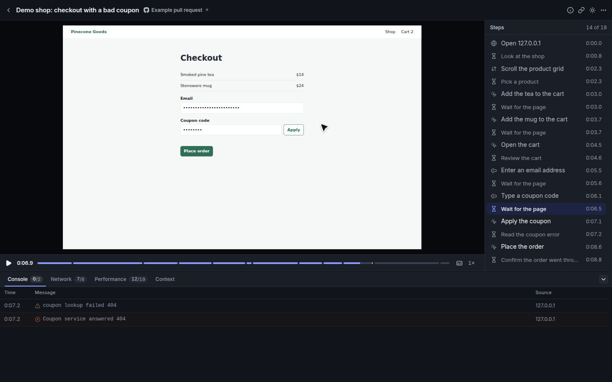
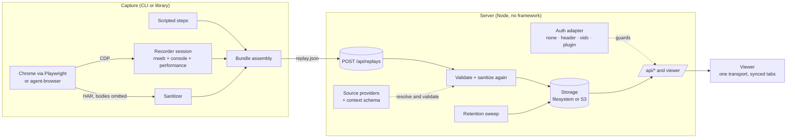
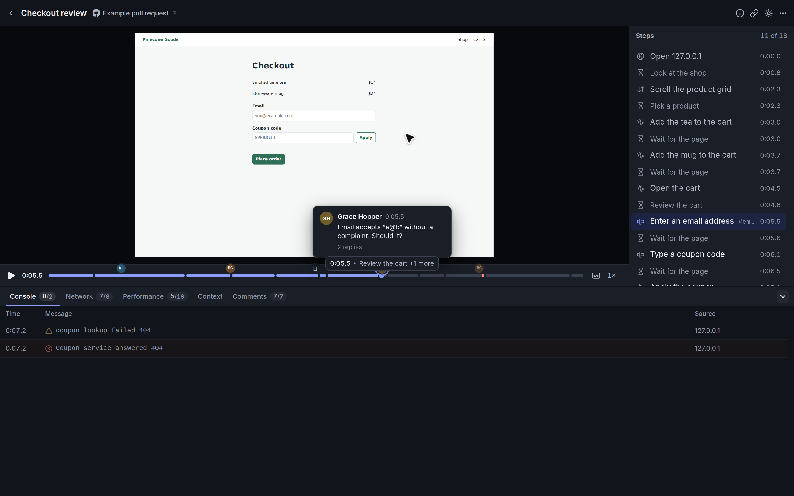
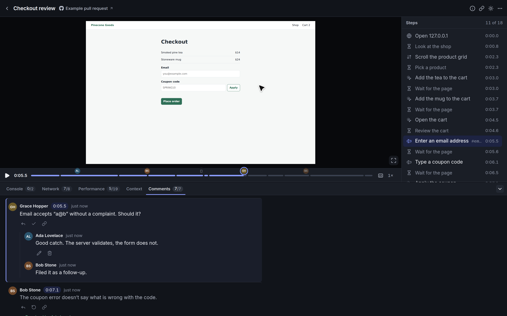
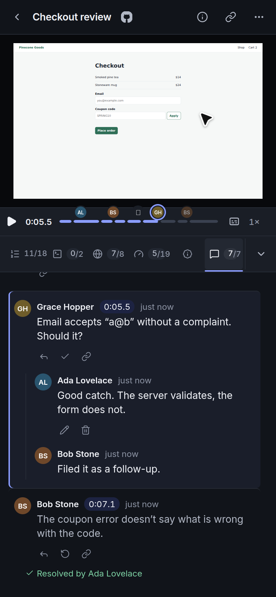
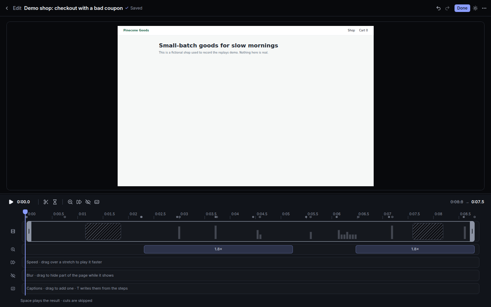
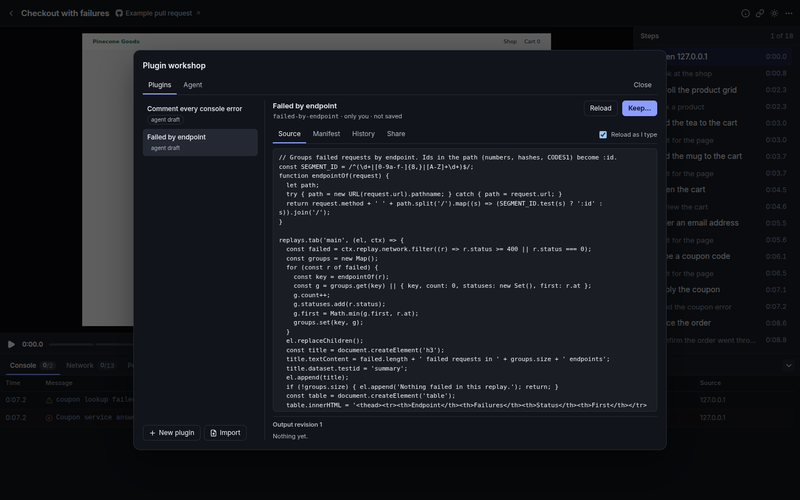
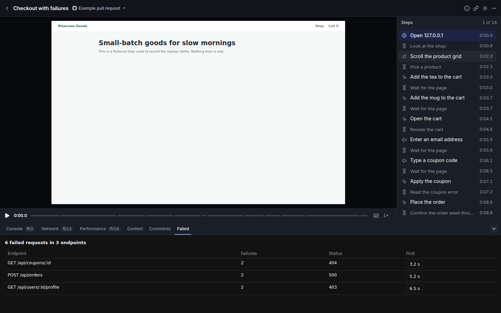
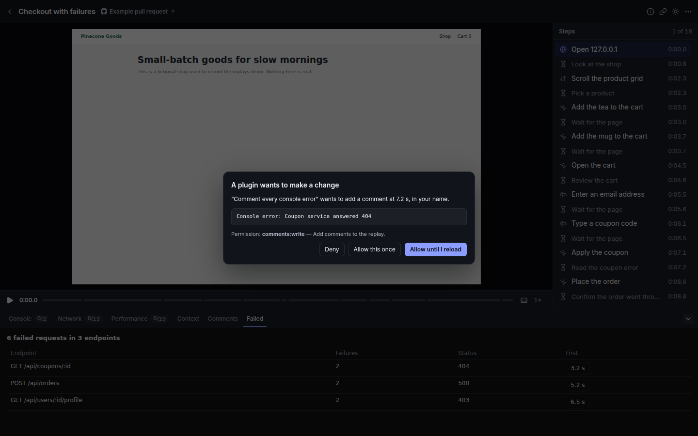

# replays

> The name is chosen (see [docs/NAMING.md](docs/NAMING.md)). It lives in `src/shared/brand.ts`, `package.json` and this
> README. npm package (not published yet): `@hazem3500/replays`; CLI: `replays`; image: `ghcr.io/hazem3500/replays`.

Record what a browser agent, a test or a person did, and replay it with everything that happened around it on **one
timeline**: the page itself (rrweb), the steps taken, console output, a sanitized network trace and performance
timings. One portable `replay.json` (plus an optional MP4), a small upload server with retention, and a viewer you
can host yourself.



- **One timeline.** rrweb events, agent steps, console, network and performance share the same millisecond clock. Click a
  step, a request or a console line and the page jumps there.
- **Built for debugging.** Error markers on the scrubber (console errors, failed requests), previous/next error,
  permalinks (`?t=6.9` or `#step-3`), keyboard shortcuts, a Context tab for test metadata, and a Waterfall tab for
  overlapping requests, actions and performance signals.
- **Capture that survives navigations.** The recorder is registered over the Chrome DevTools Protocol before the first
  page loads, pulls chunks every second and flushes on `pagehide`.
- **Private by default.** Inputs are masked at capture time; cookies, credential headers, URL credentials and sensitive
  query values are removed; request and response bodies are never stored. See the [privacy model](#privacy-model).
- **Self-hostable and pluggable.** Filesystem or S3-compatible storage, `none` / `header` / `oidc` / plugin auth, your own
  context schema, source-link providers, theming, base path, retention. Optional OpenTelemetry tracing.

## Quickstart

### Run the viewer and server

```bash
git clone https://github.com/hazem3500/replays.git && cd replays
docker compose up --build        # builds locally; nothing is pulled from or pushed to a registry
open http://localhost:8080       # two sample replays are included
```

Without Docker (Node 22.12+ and pnpm 10):

```bash
pnpm install
pnpm dev                          # http://localhost:3000, hot reload, AUTH_MODE=none
# or, production shaped:
pnpm build && pnpm start          # http://127.0.0.1:8080
```

The default `AUTH_MODE=none` is for local use. Read [Authentication](#authentication) before exposing the server.

### Capture a replay

```bash
pnpm exec playwright install chromium         # once, unless Chrome is installed (set CHROME_PATH to use it)

pnpm capture \
  --url https://example.com \
  --title "Example Domain" \
  --steps '[{"kind":"wait","ms":800},{"kind":"click","selector":"a","label":"Follow the link"}]' \
  --output ./out \
  --upload-url http://localhost:8080/api/replays      # optional: send it straight to a server
```

`./out/replay.json` is the whole recording. Open it by uploading it in the viewer (the upload button, or drag and
drop), or `POST` it to `/api/replays`. The CLI prints one JSON line (`{"success":true,…}`), so agents and CI can parse it.

Steps are a closed list: `click`, `hover`, `type`, `fill`, `press`, `wait`, `scroll`, `goto`. Arbitrary page scripts are
intentionally not a step. `--steps` takes inline JSON or `@steps.json`; `sample/demo-shop.steps.json` is a longer one.
Use `--step-pause 1200` to hold each non-wait action for a readable beat (default: 0ms, or
`capture.stepPauseMs` in your config). Built-in drivers type at 80ms per character; `fill` is immediate.
Unlabelled waits execute without adding a step. Labels use selector names without typed values.
See [capture pacing](docs/extending.md#capture-pacing) for host configuration.

```text
replays capture --url <url> --output <dir> [--steps <json|@file>] [--title] [--id] [--driver playwright|agent-browser]
                   [--viewport 1440x900] [--step-pause 0..10000] [--video] [--tag t]… [--person role:email[:handle=value]]…
                   [--source github:owner/repo#12]…
                   [--context-file f.json] [--context-schema schema.json] [--suite-id s --run-id r]
                   [--upload-url <server>/api/replays] [--header-file headers.json] [--headed]
```

`replays` is the package's `bin` (`bin/replays.mjs`); from a checkout, `pnpm cli <command>` or
`pnpm capture` run the TypeScript sources directly. The package is **not published**; see
[docs/releasing.md](docs/releasing.md).

Other commands: `replays import --rrweb events.json --title "…"` (a plain rrweb recording made by a person),
`replays upload replay.json --upload-url …`, and `replays serve`.

### Record from your own Playwright test

The recorder is a library (`import … from '@hazem3500/replays'` after `pnpm build:cli`): attach it to any Chrome DevTools
Protocol connection.

```ts
import { RecorderSession } from '@hazem3500/replays';

const session = await RecorderSession.start(await context.newCDPSession(page)); // before the first navigation
await page.goto('https://example.com');
await page.getByRole('link').click();
const tracks = await session.stop(); // { events, console, performance, origin, duration }
```

`stop()` gives the page-side tracks; combine them with a HAR (`networkEntries`) and your steps into a
`ReplayBundle` (see `src/capture/capture.ts` for the reference assembly) and upload it.

### Inspect the waterfall

Open **Waterfall** in the replay's diagnostics panel. Requests share a horizontal clock with action/paint points
and measured task spans. Select a row to seek the existing player and open details; ↑/↓, Home/End and Escape work
from the keyboard. Search and track/state filters help isolate failures, slow requests (at least 500 ms measured),
incomplete requests, or invalid durations. On narrow screens, scroll the timeline horizontally; event labels stay pinned.

With saved edits, bars follow the edited replay clock through trims, cuts and speed-ups. Labels and request details
retain source measurements; the selected event also shows its visible elapsed time. Requests crossing removed time
keep their surviving portions, even when their start was cut. Actions and paints remain points, never inferred spans.
Missing responses have unknown duration. Older bundles work with the tracks they contain; no additional capture data is needed.

## Architecture



| Part | Where |
| --- | --- |
| Recorder (page side), session, drivers, sanitizer, importers | `src/capture` |
| Bundle types and validation, context, source providers, retention | `src/shared` |
| HTTP app, auth, storage, retention, tracing, optional video/poster rendering | `src/server` |
| Viewer | `src/client` |

A replay is one JSON document:

```text
replay.json
├─ meta        id, title, url, capturedAt, duration, viewport, source (agent|human), tags
├─ events      rrweb events (masked inputs)
├─ steps       what the agent or script did, with times
├─ console     level, message, time
├─ network     method, url, status, timing, redacted request/response headers (no bodies)
├─ performance paint, long tasks, slow interactions
├─ context     optional: app/build, test, source links, your own fields
└─ suiteRun    optional: attaches the replay to a suite run
```

## Configuration reference

Settings come from environment variables. Non-secret settings can also live in a JSON file
(`REPLAYS_CONFIG=/etc/replays/config.json`); the environment wins. Secrets are environment-only.

### Server

| Variable | Default | Meaning |
| --- | --- | --- |
| `PORT` | `8080` (`3000` with `--dev`) | Listen port |
| `HOST` | `127.0.0.1` (`0.0.0.0` in the Docker image) | Listen address |
| `BASE_PATH` | `/` | Serve under a prefix, e.g. `/replays`. The bare (prefix-stripped) shape is accepted too, for proxies that strip it. `hosts` in the config file gives single hosts their own base ([operations](docs/operations.md#several-hosts-one-process)) |
| `TRUST_FORWARDED_HOST` | `false` | With `hosts`: pick the host from `X-Forwarded-Host` (a gateway that rewrites `Host`). Also `trustForwardedHost` |
| `PUBLIC_ORIGIN` | – | `https://replays.example.com`; needed by `oidc` for the redirect URI |
| `TLS_CERT_FILE`, `TLS_KEY_FILE` | – | Serve HTTPS directly (usually a proxy does this instead) |
| `DATA_DIR` | `./.data/replays` (`/data` in Docker) | Where the filesystem driver stores replays |
| `STORAGE` | `fs` | `fs`, `s3`, or a backend a plugin registered |
| `RETENTION_DAYS` | `30` | Days an upload lives, counted from its upload time; `0` keeps everything. "Kept" replays never expire |
| `RETENTION_PURPOSE_<ID>_DAYS` | – | Days for replays of one [purpose](docs/extension-api.md#purposes-and-retention) (`RETENTION_PURPOSE_DESIGN_REVIEW_DAYS`); `0` keeps explicit ones forever |
| `REPLAYS_CONFIG` | `replays.config.{ts,mjs,js,json}` in the working directory | The config file (below); a script can also list [plugins](#extending-replays) |
| `SAMPLE_DIR` | the bundled `sample/` | Directory of read-only demo replays; point it at an empty directory for none |
| `PRODUCT_NAME`, `LOGO_URL` | `replays`, – | Branding (name in the header and title; logo must be an `https:` URL or a `data:image/…;base64` URL) |
| `CONTEXT_SCHEMA_FILE` | – | JSON Schema for `context.fields` (see [Context schema](#context-metadata-schema)) |
| `GITHUB_HOST`, `GITLAB_HOST` | `github.com`, `gitlab.com` | Hosts the `github:` / `gitlab:` source providers link to (self-managed instances) |
| `OTEL_EXPORTER_OTLP_ENDPOINT` | – | Turns tracing on; standard `OTEL_*` variables apply. Off (and not even loaded) when unset |
| `REPLAYS_BETA_EDITOR` | `false` | Turns on the beta replay editor (below). Also `beta.editor` in the config file; the variable wins |
| `EDITING_ENABLED` | `true` | Host edit write policy within `beta.editor`; `false` hides editing and rejects saves while saved edits still play and export. Also `editing.enabled` in config |
| `REPLAYS_BETA_MALLEABLE` | `false` | Turns on the beta plugin workshop and agent bridge ([Malleable viewer](#malleable-viewer-beta-off-by-default)). Also `beta.malleable` in the config file; the variable wins |
| `REPLAYS_COMMENTS` | `true` | Comments on replays (below). `false` removes the UI and makes the API answer `404`. Also `comments.enabled` in the config file; the variable wins |
| `RENDER_DISABLED=1`, `POSTERS_DISABLED=1` | – | Turn off video export / list posters even when Chromium and ffmpeg exist |
| `CHROMIUM_PATH`, `FFMPEG_PATH`, `CHROMIUM_NO_SANDBOX=1` | autodetected | Server-side video export and list posters (optional) |

The config file takes `name`, `logoUrl`, `theme`, `basePath`, `hosts`, `trustForwardedHost`, `retentionDays`, `contextSchemaFile`, `githubHost`,
`gitlabHost`, `sourceProviders`, `beta`, `editing`, `comments`, `auth`, `storage` and `plugins`:

```json
{
  "name": "Acme Replays",
  "theme": { "dark": { "accent": "#7aa2ff" }, "light": { "accent": "#2f55d4" } },
  "basePath": "/replays",
  "retentionDays": 14,
  "contextSchemaFile": "./context.schema.json",
  "sourceProviders": [{ "id": "jira", "label": "Jira", "template": "https://jira.example.com/browse/{ref}", "pattern": "^[A-Z]+-\\d+$" }]
}
```

### Storage

| Variable | Meaning |
| --- | --- |
| `STORAGE=fs` | Files under `DATA_DIR` (default) |
| `STORAGE=s3` | An S3-compatible bucket: `S3_BUCKET` (required), `S3_REGION` (`us-east-1`), `S3_ENDPOINT` (MinIO, R2, …), `S3_FORCE_PATH_STYLE=1`, `S3_PREFIX`, and credentials from `AWS_ACCESS_KEY_ID`, `AWS_SECRET_ACCESS_KEY`, `AWS_SESSION_TOKEN` |

### Capture

| Variable | Meaning |
| --- | --- |
| `CHROME_PATH` | Chrome/Chromium binary for the Playwright driver (default: Playwright's own browser) |
| `CHROMIUM_NO_SANDBOX=1` | Pass `--no-sandbox` (containers) |
| `FFMPEG_PATH` | ffmpeg for `--video` with the Playwright driver |
| `AGENT_BROWSER_BIN` | Binary of the optional `agent-browser` driver |

## Authentication

One adapter per process, chosen by `AUTH_MODE`. Everything except `GET /healthz` (and `GET /` from a non-browser) goes
through it, and state-changing requests from a browser must be same-origin (`Sec-Fetch-Site`).

| `AUTH_MODE` | Behaviour | Settings |
| --- | --- | --- |
| `none` (default) | Everyone is one anonymous user. For local use, or a network that already decides who may connect. A warning is logged when it listens on a non-loopback address | `DEV_USER` names the identity |
| `header` | Trust an identity header set by a reverse proxy that already authenticated the user (oauth2-proxy, an ingress, …). Only requests from `AUTH_TRUSTED_PROXIES` count | `AUTH_HEADER`, `AUTH_TRUSTED_PROXIES` (IPs or IPv4 CIDRs, **required**), `AUTH_NAME_HEADER`, `AUTH_ALLOW` (`@domain` or exact ids) |
| `oidc` | OpenID Connect sign-in (authorization code + PKCE, signed session cookie). `Authorization: Bearer <jwt>` is accepted for machine uploads | `OIDC_ISSUER`, `OIDC_CLIENT_ID`, `OIDC_CLIENT_SECRET`, `OIDC_SESSION_SECRET`, `PUBLIC_ORIGIN`, `OIDC_SCOPES`, `OIDC_AUDIENCE`, `AUTH_ALLOW` |
| `plugin` | Your own adapter: `AUTH_PLUGIN=./my-auth.mjs`, default export `(env) => AuthAdapter` | whatever the plugin reads |

[`examples/auth-signed-header`](examples/auth-signed-header) is a worked plugin: it verifies a signed JWT that an
identity-aware proxy forwards in a header (signature, issuer, audience, expiry).

Uploads from CI need credentials the adapter understands: a bearer token for `oidc`, or whatever your proxy requires
(`--header-file headers.json` adds headers to the upload).

## Extension points

All of these are typed, documented in [docs/extending.md](docs/extending.md) and covered by tests.

| Extension point | What you provide | Built in |
| --- | --- | --- |
| **Auth adapter** | `AuthAdapter { authenticate, handle?, loginUrl? }` | `none`, `header`, `oidc`; example plugin in `examples/` |
| **Context metadata schema** | A JSON Schema file. Uploads whose `context.fields` do not match are refused (400 with the field path); the viewer renders the fields with your titles, descriptions, order and `format: uri` links | – |
| **Source-link providers** | `--source github:owner/repo#12` → a link. `{ id, template: 'https://…/{ref}', pattern? }` for your tracker | `github`, `gitlab`, `url` |
| **Storage** | `ObjectStorage` interface (read, write with `createOnly`/`ifVersion`, list, delete, stream with ranges) | `FsStorage`, `S3Storage` (SigV4 over `fetch`, no SDK); `MemoryStorage` for tests |
| **Theming and branding** | `PRODUCT_NAME`, `LOGO_URL`, `theme.dark` / `theme.light` design tokens (`accent`, `surface`, `text`, `line`, `ring`, `sans`, …) applied at runtime without a rebuild | Neutral indigo/slate theme |
| **Base path, retention** | `BASE_PATH`, `RETENTION_DAYS` | – |
| **Capture driver** | `CaptureDriver` interface (launch, open, step, finish) | `playwright`, `agent-browser` |

### Context (metadata schema)

A producer can attach a context block to a recording: which app and build, which test, links, and fields of your own.

```json
{
  "app": { "name": "Demo shop", "environment": "staging", "version": "2.4.1", "commit": "a1b2c3d" },
  "test": { "suite": "checkout", "case": "rejects an unknown coupon", "runId": "ci-8421" },
  "sources": [{ "provider": "github", "ref": "acme/shop#42" }, { "provider": "jira", "ref": "SHOP-17" }],
  "fields": { "plan": "trial", "featureFlags": { "newCheckout": true } }
}
```

```bash
replays capture … --context-file context.json --context-schema context.schema.json
```

It comes from your runner; the CLI never reads the page's storage or an account. With `CONTEXT_SCHEMA_FILE` set, the
server validates `fields` (JSON Schema 2020-12 via Ajv, with string formats) and `GET /api/config` hands the schema to
the viewer, which uses `title`, `description`, property order and `format: "uri"` to render the Context tab. Without a
schema, fields still render, with humanized key names.

## Extending replays

To run your own branded, authenticated variant without forking, depend on this package and describe the differences in a
config file and plugins. One package, six entry points (`/config`, `/plugin`, `/viewer`, `/server`, `/capture` and the root):

```ts
// replays.config.ts
import { defineConfig } from '@hazem3500/replays/config';
import { definePlugin } from '@hazem3500/replays/plugin';

const acme = definePlugin({
  name: 'acme',
  setup(api) {
    api.auth({ name: 'acme-sso', create: (env) => ({ name: 'acme-sso', authenticate: (request) => (request.headers['x-team-key'] === env.TEAM_KEY ? { id: 'team' } : undefined) }) });
    api.contextAdapter({ name: 'build', schema: { type: 'object', properties: { env: { type: 'string', title: 'Environment' } } } });
    api.branding({ name: 'Acme Replays', theme: { dark: { accent: '#ff6600' } } });
    api.basePath('/replays');
    api.client({ id: 'main', script: new URL('./dist/client.js', import.meta.url).pathname }); // inspector tabs, actions, panels
  },
});

export default defineConfig({ plugins: [acme] });
```

Plugins can register auth adapters, test-context adapters, source-link providers, storage backends, branding, the base path, server hooks
(request, response, upload lifecycle) and a browser entry that adds inspector tabs, viewer actions and panels. Start it with
`replays serve`, or `startServer()` from `@hazem3500/replays/server`.

- [docs/extension-api.md](docs/extension-api.md): the reference, with every registration, ordering and conflict rule
- [docs/api-stability.md](docs/api-stability.md): what is public API, versioning and deprecation rules
- [docs/packaging.md](docs/packaging.md): why one package with subpath exports
- [`examples/custom-distro`](examples/custom-distro): a runnable distribution (signed-header auth, context adapter, branding, base
  path, a custom tab, action and panel) with an end-to-end test that proves each extension is active
- [docs/downstream-migration.md](docs/downstream-migration.md): moving an existing internal fork onto this surface

## Privacy model

A replay contains what was on the screen, so the defaults are conservative and the server does not trust its clients.

| Data | What happens | Where |
| --- | --- | --- |
| Typed input | rrweb `maskAllInputs` (plus `hidden` inputs): values never leave the page. Uploads and imports are re-masked on the server | `src/capture/injected-recorder.ts`, `sanitize.ts` |
| Cookies | Not stored: no `Cookie` / `Set-Cookie` headers, no HAR `cookies` arrays | `sanitize.ts` |
| Credential headers | `Authorization`, `Proxy-Authorization`, `X-Api-Key`, `X-Auth-Token`, anything ending in `-token`, `-secret`, `-jwt`, `-assertion` are dropped | `sanitize.ts` |
| URL credentials | `user:pass@` removed everywhere (events, steps, network, console, context) | `sanitize.ts` |
| Sensitive query values | `token`, `api_key`, `password`, `session`, `code`, `email`, `signature`, … (and `*_token`, `*-secret`, …) become `[redacted]`, also inside URL fragments and in text | `sanitize.ts` |
| Request and response bodies | Never captured (HAR with content omitted; only a whitelist of fields reaches the bundle) | `capture.ts`, `drivers/` |
| Uploads | Sanitized again on the server before storing; the pass is idempotent | `app.ts` |
| Your own rules | Extra headers, query parameters, JSON keys, text patterns and mask selectors from the config's `redaction` or a plugin's `api.redaction`, applied at capture and again on upload. They add to the defaults and cannot turn any off ([docs/extending.md](docs/extending.md#redaction-rules)) | `src/shared/redaction.ts` |
| Retention | Uploads expire after `RETENTION_DAYS`, from the *server's* upload time; "keep" pins one | `src/shared/retention.ts` |
| Links in the viewer | Only `https:` URLs without credentials are rendered as links | `shared/context.ts` |
| Server-side render route | Loopback-only, per-process token, refused when any proxy header is present | `render-routes.ts` |
| Telemetry | The viewer and server send nothing anywhere. Optional OTLP traces carry route templates, ids, sizes and counts, never titles, URLs, bodies or identities | `tracing.ts` |

What the sanitizer cannot know: text that is *visible on the page* (names, order numbers, messages) is recorded as
shown. Keep the server behind authentication, keep retention short, and do not record real users' production sessions
without a legal basis. Report privacy bugs through [SECURITY.md](SECURITY.md).

## Comments

Anyone who can open a replay can comment on it, Loom style. A comment is about the **whole replay** or **pinned to a
moment**; pinned ones are markers (avatar or initials) on the seek bar, with a hover card; a click seeks there. The
**Comments** tab lists every thread in time order, highlights the one at the playhead and follows it while the replay
plays. Threads take replies and can be **resolved** and reopened by anyone; **edit and delete are for the author only**
(deleting a thread deletes its replies). Emoji **reactions** (👍 🎉 👀 🤔 🐛) can be pinned to a moment too.

- **Shortcut.** `M` pauses and starts a comment at the current time (`C` is Console and `Shift C` the step captions, so
  it was taken); `Ctrl`/`⌘` + `Enter` posts. It is in the `?` sheet. Shortcuts pause while you type.
- **Permalinks.** *Copy link* on a comment gives `…/r/<id>?t=5.0#comment-<id>`: it opens the Comments tab on that comment
  and seeks to it. `?t=` is the fallback; the comment decides.
- **Anchoring.** Comment times are stored on the **source** timeline (ms from the first event of the recorded replay), the
  same clock saved edits use, so editing never moves a comment. With the beta editor's edits applied
  (`REPLAYS_BETA_EDITOR=true`) markers are mapped source → edited time (trims shift them, cuts close up, speed-ups
  compress), and a comment made while watching the edited version is mapped back. A comment inside a trimmed or cut stretch
  stays in the list, marked **In removed section** with a *View in original* link (`?original=1`); it has no marker and
  does not seek. The original recording shows every marker.
- **Who.** Authors come from the auth adapter (`id` for ownership, `name`, optional `avatarUrl`; the OIDC adapter reads the
  `picture` claim, plugins may return `avatarUrl`). Other viewers only get the display name and a `mine` flag, never the
  id. With `AUTH_MODE=none` there is no identity to speak of: comments are posted as **Anonymous**, the panel says so, and
  anyone with access can edit or delete anonymous comments.
- **Limits.** 2000 characters per comment, 500 comments per replay, 100 replies per thread; control and bidi-override
  characters are stripped and URLs in the text get the upload redaction. Creating and editing are limited to 20 per minute
  per person (`429` with `Retry-After`). Comments live in `<id>/comments.json` on the storage driver (filesystem or S3), so
  retention deletes them with the replay and **Keep** keeps them.
- **Flag.** On by default. `REPLAYS_COMMENTS=false` (or `{ "comments": { "enabled": false } }`) removes the tab, markers
  and shortcut, never requests comments, and answers the API with `404`; stored comments stay until retention.
- **A built-in plugin.** Comments are the `comments` plugin of the [extension surface](#extending-replays): the API is a request hook
  behind whatever auth adapter is in use (a plugin's adapter included: its identity, name and `avatarUrl` become the author), and
  the tab, seek-bar markers and `M` key are the matching viewer feature. Turning comments off means the plugin is not loaded.





## Replay editor (beta, off by default)

Edit mode lets you tidy a recording without touching it: trim the start and end, cut ranges, **Remove waits** (cuts the
idle stretches between steps), speed a stretch up, add **zoom** regions on the clicks, **blur boxes** over parts of the
page, and **captions** (written from the steps). Open it with the *Edit* button in the viewer or at `/r/<id>/edit`.

- **Non-destructive.** Edits are an edit list stored next to the replay (`<id>/edits.json`); `replay.json` is never
  rewritten. The viewer plays the edited version with an "Edited" label and a switch to the original (`?original=1`);
  video exports apply the edits and are cached per edit-list version. Saves are optimistic (`If-Match`), so two people
  cannot silently overwrite each other, and free text in labels goes through the same URL redaction as uploads.
- **Flag.** `REPLAYS_BETA_EDITOR=true`, or `{ "beta": { "editor": true } }` in the config file (the variable wins).
  The server tells the page through `<meta name="app-beta">` and `GET /api/config` (`beta.editor`).
- **Read-only editing.** Keep `beta.editor` on and set `{ "editing": { "enabled": false } }` or `EDITING_ENABLED=false`.
  Edit links disappear and edit deep links open playback. Saved edits still play and export; GET/HEAD edits and ETag
  revalidation work, while PUT returns `403`. `GET /api/config` reports the effective `editing.enabled` capability.
  See [host editing policy](docs/extension-api.md#host-editing-write-policy) for precedence and validation.
- **With the flag off** (the default): no Edit button or "Edited" label, `/r/<id>/edit` just opens the replay, the
  `GET|PUT /api/replays/<id>/edits` endpoints answer `404`, exports ignore any edit list, and the editor's code chunk is
  never requested. There is deliberately no client-only switch: an editor without its API cannot save, so the flag
  lives on the server. For local preview run `REPLAYS_BETA_EDITOR=true pnpm dev`.
- It is a beta: the edit-list format (`src/shared/edits.ts`, `src/shared/effects.ts`) may still change before 1.0.



## Malleable viewer (beta, off by default)

The viewer can be reshaped while it runs: write a small **plugin** (an inspector tab, a side panel, a More-menu action) in an in-app
editor and it hot-loads; keep it as a versioned, diffable, revertable file, per user or for the workspace; or let a **coding agent**
read the open replay and write the plugin for you ("add a tab that groups failed requests by endpoint", "comment on every console
error"). Plugins run in a sandboxed frame with no network, no cookies and no access to the page; they can only use the capabilities
their manifest declares, and anything that writes (a comment, a download) asks you first. Nothing is stored unless you approve it
in a dialog that shows the diff and the permissions, and an agent has no way to save anything.

- **Flag.** `REPLAYS_BETA_MALLEABLE=true`, or `{ "beta": { "malleable": true } }` in the config file (the variable wins). The page
  learns it from `<meta name="app-beta">` and `GET /api/config` (`beta.malleable`). Open **More → Plugin workshop** in a replay.
- **Agents.** In the page, tools are registered with [WebMCP](https://webmachinelearning.github.io/webmcp/) (`document.modelContext`;
  a small stand-in is installed where the browser has none). From outside, *Agent → Connect an agent* shows a one-tab bridge token for
  `replays mcp`, an MCP server over stdio (`REPLAYS_URL=… REPLAYS_BRIDGE_TOKEN=… replays mcp`). The tools read live state (open replay,
  playhead, comments, network and console) and load *draft* plugins; there is no save tool.
- **Formats.** Replays, comments, edits and plugins are plain JSON with JSON Schemas in [docs/formats/](docs/formats/); example plugins
  are in [examples/malleable/](examples/malleable/) (import them from the workshop).
- **Read-only editing.** Keep `beta.editor` on and set `{ "editing": { "enabled": false } }` or `EDITING_ENABLED=false`.
  Edit links disappear and edit deep links open playback. Saved edits still play and export; GET/HEAD edits and ETag
  revalidation work, while PUT returns `403`. `GET /api/config` reports the effective `editing.enabled` capability.
  See [host editing policy](docs/extension-api.md#host-editing-write-policy) for precedence and validation.
- **With the flag off** (the default): no workshop or menu entry, `/api/malleable/*` and `/_malleable/sandbox.html` answer `404`, no
  tools are registered, no extra CSP header is sent, and the plugin code is never requested.
- Design, mapping onto the extension API, the threat model and worked examples: [docs/malleability.md](docs/malleability.md).





## Suites, retention and keep

A **suite** groups the runs of one job (for example every browser flow a pull request triggered): register it with
`PUT /api/suites/<id>` and each run with `PUT /api/suites/<id>/runs/<run>`, then upload each replay with
`--suite-id` / `--run-id`. The viewer shows the suite's runs, status and a link to its subject. **Keep** (`PUT
/api/replays/<id>/keep`) exempts a replay or suite from retention and records who kept it.

## HTTP API

| Route | |
| --- | --- |
| `GET /healthz` | `200 ok`, no auth |
| `POST /api/replays` | Upload a `replay.json` (≤ 25 MB, optionally `Content-Encoding: gzip`) → `201 { id, url }` |
| `POST /api/replays/import` | Upload plain rrweb JSON (`?title=&url=&id=&tag=`) |
| `PUT /api/replays/<id>/video` | Attach an MP4 |
| `GET /api/replays`, `GET /api/replays/<id>` | List summaries (`?q=&host=&errors=1&source=&tag=`) / the bundle |
| `GET /api/suites`, `GET /api/suites/<id>`, `PUT /api/suites/<id>[/runs/<run>]` | Suites |
| `PUT\|DELETE /api/replays/<id>/keep` | Keep / release |
| `GET\|POST /api/replays/<id>/comments`, `PATCH\|DELETE …/comments/<comment>` | Comments (`{ body, at?, parentId? }`, `{ emoji, at }`, `{ body }` / `{ resolved }`); `at` is source ms |
| `GET /api/me`, `GET /api/config` | Identity; branding and context schema |
| `GET /api/malleable/plugins[/<scope>/<id>]`, `POST …/approvals`, `PUT\|DELETE …/plugins/<scope>/<id>`, `…/bridge/*`, `GET /_malleable/sandbox.html` | User plugins and the agent bridge (beta, `REPLAYS_BETA_MALLEABLE`; `404` when off). Saves need an approval token |

## Development

```bash
pnpm install
pnpm dev          # server + viewer with hot reload
pnpm check        # lint, format check, typecheck, unit tests, build
pnpm test:e2e     # Playwright: capture a sample → upload → viewer loads it, plus UI smoke tests
pnpm build:cli    # dist/cli (bundled CLI), dist/lib (library entries), dist/types
pnpm test:distro  # build everything, then the custom-distro example and its end-to-end smoke
pnpm test:pack    # pack the package and run it from an install outside the repository
pnpm sample       # re-record sample/demo-shop.json from fixtures/demo-shop
pnpm build:site   # the static landing page and live demo in dist/site (see docs/site.md)
```

Requirements: Node 22.12+, pnpm 10, a Chrome/Chromium for capture and the e2e tests. See [CONTRIBUTING.md](CONTRIBUTING.md).

More documentation: [extending replays](docs/extension-api.md) · [API stability](docs/api-stability.md) · [extension points](docs/extending.md) · [operations](docs/operations.md) ·
[releasing](docs/releasing.md) · [landing page](docs/site.md) · [naming](docs/NAMING.md).

## License

[MIT](LICENSE) © 2026 Hazem (hazem3500). rrweb is MIT licensed; the Inter font is bundled under the SIL OFL
(`src/client/fonts/Inter-OFL-LICENSE.txt`).

### Component development and agent framework evaluation

`pnpm storybook` runs isolated viewer, host-context and plugin-permission stories with a light/dark theme toolbar; `pnpm build:storybook` produces a static build. See [Storybook and the Agent-Native adoption design](docs/agent-native-adoption.md) for scope, validation and the evaluated fit of Effect and XState. [The Agent-Native integration spike](examples/agent-native/README.md) uses the actual framework browser client with the existing WebMCP bridge. It is the first migration slice toward Agent-Native as the default application runtime, preserving human Keep approval and portable core storage/auth.
