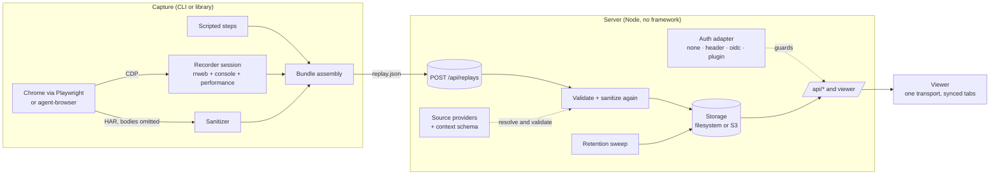

# Replay Kit

> **Replay Kit** is a placeholder name (see [docs/NAMING.md](docs/NAMING.md)). It lives in `src/shared/brand.ts`,
> `package.json` and this README, so renaming is a five-minute change.

Record what a browser agent, a test or a person did, and replay it with everything that happened around it on **one
timeline**: the page itself (rrweb), the steps taken, console output, a sanitized network trace and performance
timings. One portable `replay.json` (plus an optional MP4), a small upload server with retention, and a viewer you
can host yourself.


- **One timeline.** rrweb events, agent steps, console, network and performance share the same millisecond clock. Click a
  step, a request or a console line and the page jumps there.
- **Built for debugging.** Error markers on the scrubber (console errors, failed requests), previous/next error,
  permalinks (`?t=6.9` or `#step-3`), keyboard shortcuts, a Context tab for test metadata.
- **Capture that survives navigations.** The recorder is registered over the Chrome DevTools Protocol before the first
  page loads, pulls chunks every second and flushes on `pagehide`.
- **Private by default.** Inputs are masked at capture time; cookies, credential headers, URL credentials and sensitive
  query values are removed; request and response bodies are never stored. See the [privacy model](#privacy-model).
- **Self-hostable and pluggable.** Filesystem or S3-compatible storage, `none` / `header` / `oidc` / plugin auth, your own
  context schema, source-link providers, theming, base path, retention. Optional OpenTelemetry tracing.

## Quickstart

### Run the viewer and server

```bash
git clone https://github.com/hazem3500/replay-kit.git && cd replay-kit
docker compose up --build        # builds locally; nothing is pulled from or pushed to a registry
open http://localhost:8080       # two sample replays are included
```

Without Docker (Node 22.12+ and pnpm 10):

```bash
pnpm install
pnpm dev                          # http://localhost:3000, hot reload, AUTH_MODE=none
# or, production shaped:
pnpm build && pnpm start          # http://127.0.0.1:8080
```

The default `AUTH_MODE=none` is for local use. Read [Authentication](#authentication) before exposing the server.

### Capture a replay

```bash
pnpm exec playwright install chromium         # once, unless Chrome is installed (set CHROME_PATH to use it)

pnpm capture \
  --url https://example.com \
  --title "Example Domain" \
  --steps '[{"kind":"wait","ms":800},{"kind":"click","selector":"a","label":"Follow the link"}]' \
  --output ./out \
  --upload-url http://localhost:8080/api/replays      # optional: send it straight to a server
```

`./out/replay.json` is the whole recording. Open it by uploading it in the viewer (the upload button, or drag and
drop), or `POST` it to `/api/replays`. The CLI prints one JSON line (`{"success":true,…}`), so agents and CI can parse it.

Steps are a closed list: `click`, `hover`, `type`, `fill`, `press`, `wait`, `scroll`, `goto`. Arbitrary page scripts are
intentionally not a step. `--steps` takes inline JSON or `@steps.json`; `sample/demo-shop.steps.json` is a longer one.

```text
replay-kit capture --url <url> --output <dir> [--steps <json|@file>] [--title] [--id] [--driver playwright|agent-browser]
                   [--viewport 1440x900] [--video] [--tag t]… [--source github:owner/repo#12]…
                   [--context-file f.json] [--context-schema schema.json] [--suite-id s --run-id r]
                   [--upload-url <server>/api/replays] [--header-file headers.json] [--headed]
```

`replay-kit` is the package's `bin` (`bin/replay-kit.mjs`); from a checkout, `pnpm cli <command>` or
`pnpm capture` run the TypeScript sources directly. The package is **not published**; see
[docs/releasing.md](docs/releasing.md).

Other commands: `replay-kit import --rrweb events.json --title "…"` (a plain rrweb recording made by a person),
`replay-kit upload replay.json --upload-url …`, and `replay-kit serve`.

### Record from your own Playwright test

The recorder is a library (`import … from 'replay-kit'` after `pnpm build:cli`): attach it to any Chrome DevTools
Protocol connection.

```ts
import { RecorderSession } from 'replay-kit';

const session = await RecorderSession.start(await context.newCDPSession(page)); // before the first navigation
await page.goto('https://example.com');
await page.getByRole('link').click();
const tracks = await session.stop(); // { events, console, performance, origin, duration }
```

`stop()` gives the page-side tracks; combine them with a HAR (`networkEntries`) and your steps into a
`ReplayBundle` (see `src/capture/capture.ts` for the reference assembly) and upload it.

## Architecture



| Part | Where |
| --- | --- |
| Recorder (page side), session, drivers, sanitizer, importers | `src/capture` |
| Bundle types and validation, context, source providers, retention | `src/shared` |
| HTTP app, auth, storage, retention, tracing, optional video/poster rendering | `src/server` |
| Viewer | `src/client` |

A replay is one JSON document:

```text
replay.json
├─ meta        id, title, url, capturedAt, duration, viewport, source (agent|human), tags
├─ events      rrweb events (masked inputs)
├─ steps       what the agent or script did, with times
├─ console     level, message, time
├─ network     method, url, status, timing, redacted request/response headers (no bodies)
├─ performance paint, long tasks, slow interactions
├─ context     optional: app/build, test, source links, your own fields
└─ suiteRun    optional: attaches the replay to a suite run
```

## Configuration reference

Settings come from environment variables. Non-secret settings can also live in a JSON file
(`REPLAY_KIT_CONFIG=/etc/replay-kit/config.json`); the environment wins. Secrets are environment-only.

### Server

| Variable | Default | Meaning |
| --- | --- | --- |
| `PORT` | `8080` (`3000` with `--dev`) | Listen port |
| `HOST` | `127.0.0.1` (`0.0.0.0` in the Docker image) | Listen address |
| `BASE_PATH` | `/` | Serve under a prefix, e.g. `/replays`. The bare (prefix-stripped) shape is accepted too, for proxies that strip it |
| `PUBLIC_ORIGIN` | – | `https://replays.example.com`; needed by `oidc` for the redirect URI |
| `TLS_CERT_FILE`, `TLS_KEY_FILE` | – | Serve HTTPS directly (usually a proxy does this instead) |
| `DATA_DIR` | `./.data/replays` (`/data` in Docker) | Where the filesystem driver stores replays |
| `STORAGE` | `fs` | `fs` or `s3` |
| `RETENTION_DAYS` | `30` | Days an upload lives, counted from its upload time; `0` keeps everything. "Kept" replays never expire |
| `REPLAY_KIT_CONFIG` | – | Path of the JSON config file (below) |
| `PRODUCT_NAME`, `LOGO_URL` | `Replay Kit`, – | Branding (name in the header and title; logo must be an `https:` URL or a `data:image/…;base64` URL) |
| `CONTEXT_SCHEMA_FILE` | – | JSON Schema for `context.fields` (see [Context schema](#context-metadata-schema)) |
| `GITHUB_HOST`, `GITLAB_HOST` | `github.com`, `gitlab.com` | Hosts the `github:` / `gitlab:` source providers link to (self-managed instances) |
| `OTEL_EXPORTER_OTLP_ENDPOINT` | – | Turns tracing on; standard `OTEL_*` variables apply. Off (and not even loaded) when unset |
| `RENDER_DISABLED=1`, `POSTERS_DISABLED=1` | – | Turn off video export / list posters even when Chromium and ffmpeg exist |
| `CHROMIUM_PATH`, `FFMPEG_PATH`, `CHROMIUM_NO_SANDBOX=1` | autodetected | Server-side video export and list posters (optional) |

The config file takes `name`, `logoUrl`, `theme`, `basePath`, `retentionDays`, `contextSchemaFile`, `githubHost`,
`gitlabHost` and `sourceProviders`:

```json
{
  "name": "Acme Replays",
  "theme": { "dark": { "accent": "#7aa2ff" }, "light": { "accent": "#2f55d4" } },
  "basePath": "/replays",
  "retentionDays": 14,
  "contextSchemaFile": "./context.schema.json",
  "sourceProviders": [{ "id": "jira", "label": "Jira", "template": "https://jira.example.com/browse/{ref}", "pattern": "^[A-Z]+-\\d+$" }]
}
```

### Storage

| Variable | Meaning |
| --- | --- |
| `STORAGE=fs` | Files under `DATA_DIR` (default) |
| `STORAGE=s3` | An S3-compatible bucket: `S3_BUCKET` (required), `S3_REGION` (`us-east-1`), `S3_ENDPOINT` (MinIO, R2, …), `S3_FORCE_PATH_STYLE=1`, `S3_PREFIX`, and credentials from `AWS_ACCESS_KEY_ID`, `AWS_SECRET_ACCESS_KEY`, `AWS_SESSION_TOKEN` |

### Capture

| Variable | Meaning |
| --- | --- |
| `CHROME_PATH` | Chrome/Chromium binary for the Playwright driver (default: Playwright's own browser) |
| `CHROMIUM_NO_SANDBOX=1` | Pass `--no-sandbox` (containers) |
| `FFMPEG_PATH` | ffmpeg for `--video` with the Playwright driver |
| `AGENT_BROWSER_BIN` | Binary of the optional `agent-browser` driver |

## Authentication

One adapter per process, chosen by `AUTH_MODE`. Everything except `GET /healthz` (and `GET /` from a non-browser) goes
through it, and state-changing requests from a browser must be same-origin (`Sec-Fetch-Site`).

| `AUTH_MODE` | Behaviour | Settings |
| --- | --- | --- |
| `none` (default) | Everyone is one anonymous user. For local use, or a network that already decides who may connect. A warning is logged when it listens on a non-loopback address | `DEV_USER` names the identity |
| `header` | Trust an identity header set by a reverse proxy that already authenticated the user (oauth2-proxy, an ingress, …). Only requests from `AUTH_TRUSTED_PROXIES` count | `AUTH_HEADER`, `AUTH_TRUSTED_PROXIES` (IPs or IPv4 CIDRs, **required**), `AUTH_NAME_HEADER`, `AUTH_ALLOW` (`@domain` or exact ids) |
| `oidc` | OpenID Connect sign-in (authorization code + PKCE, signed session cookie). `Authorization: Bearer <jwt>` is accepted for machine uploads | `OIDC_ISSUER`, `OIDC_CLIENT_ID`, `OIDC_CLIENT_SECRET`, `OIDC_SESSION_SECRET`, `PUBLIC_ORIGIN`, `OIDC_SCOPES`, `OIDC_AUDIENCE`, `AUTH_ALLOW` |
| `plugin` | Your own adapter: `AUTH_PLUGIN=./my-auth.mjs`, default export `(env) => AuthAdapter` | whatever the plugin reads |

[`examples/auth-signed-header`](examples/auth-signed-header) is a worked plugin: it verifies a signed JWT that an
identity-aware proxy forwards in a header (signature, issuer, audience, expiry).

Uploads from CI need credentials the adapter understands: a bearer token for `oidc`, or whatever your proxy requires
(`--header-file headers.json` adds headers to the upload).

## Extension points

All of these are typed, documented in [docs/extending.md](docs/extending.md) and covered by tests.

| Extension point | What you provide | Built in |
| --- | --- | --- |
| **Auth adapter** | `AuthAdapter { authenticate, handle?, loginUrl? }` | `none`, `header`, `oidc`; example plugin in `examples/` |
| **Context metadata schema** | A JSON Schema file. Uploads whose `context.fields` do not match are refused (400 with the field path); the viewer renders the fields with your titles, descriptions, order and `format: uri` links | – |
| **Source-link providers** | `--source github:owner/repo#12` → a link. `{ id, template: 'https://…/{ref}', pattern? }` for your tracker | `github`, `gitlab`, `url` |
| **Storage** | `ObjectStorage` interface (read, write with `createOnly`/`ifVersion`, list, delete, stream with ranges) | `FsStorage`, `S3Storage` (SigV4 over `fetch`, no SDK); `MemoryStorage` for tests |
| **Theming and branding** | `PRODUCT_NAME`, `LOGO_URL`, `theme.dark` / `theme.light` design tokens (`accent`, `surface`, `text`, `line`, `ring`, `sans`, …) applied at runtime without a rebuild | Neutral indigo/slate theme |
| **Base path, retention** | `BASE_PATH`, `RETENTION_DAYS` | – |
| **Capture driver** | `CaptureDriver` interface (launch, open, step, finish) | `playwright`, `agent-browser` |

### Context (metadata schema)

A producer can attach a context block to a recording: which app and build, which test, links, and fields of your own.

```json
{
  "app": { "name": "Demo shop", "environment": "staging", "version": "2.4.1", "commit": "a1b2c3d" },
  "test": { "suite": "checkout", "case": "rejects an unknown coupon", "runId": "ci-8421" },
  "sources": [{ "provider": "github", "ref": "acme/shop#42" }, { "provider": "jira", "ref": "SHOP-17" }],
  "fields": { "plan": "trial", "featureFlags": { "newCheckout": true } }
}
```

```bash
replay-kit capture … --context-file context.json --context-schema context.schema.json
```

It comes from your runner; the CLI never reads the page's storage or an account. With `CONTEXT_SCHEMA_FILE` set, the
server validates `fields` (JSON Schema 2020-12 via Ajv, with string formats) and `GET /api/config` hands the schema to
the viewer, which uses `title`, `description`, property order and `format: "uri"` to render the Context tab. Without a
schema, fields still render, with humanized key names.

## Privacy model

A replay contains what was on the screen, so the defaults are conservative and the server does not trust its clients.

| Data | What happens | Where |
| --- | --- | --- |
| Typed input | rrweb `maskAllInputs` (plus `hidden` inputs): values never leave the page. Uploads and imports are re-masked on the server | `src/capture/injected-recorder.ts`, `sanitize.ts` |
| Cookies | Not stored: no `Cookie` / `Set-Cookie` headers, no HAR `cookies` arrays | `sanitize.ts` |
| Credential headers | `Authorization`, `Proxy-Authorization`, `X-Api-Key`, `X-Auth-Token`, anything ending in `-token`, `-secret`, `-jwt`, `-assertion` are dropped | `sanitize.ts` |
| URL credentials | `user:pass@` removed everywhere (events, steps, network, console, context) | `sanitize.ts` |
| Sensitive query values | `token`, `api_key`, `password`, `session`, `code`, `email`, `signature`, … (and `*_token`, `*-secret`, …) become `[redacted]`, also inside URL fragments and in text | `sanitize.ts` |
| Request and response bodies | Never captured (HAR with content omitted; only a whitelist of fields reaches the bundle) | `capture.ts`, `drivers/` |
| Uploads | Sanitized again on the server before storing; the pass is idempotent | `app.ts` |
| Retention | Uploads expire after `RETENTION_DAYS`, from the *server's* upload time; "keep" pins one | `src/shared/retention.ts` |
| Links in the viewer | Only `https:` URLs without credentials are rendered as links | `shared/context.ts` |
| Server-side render route | Loopback-only, per-process token, refused when any proxy header is present | `render-routes.ts` |
| Telemetry | The viewer and server send nothing anywhere. Optional OTLP traces carry route templates, ids, sizes and counts, never titles, URLs, bodies or identities | `tracing.ts` |

What the sanitizer cannot know: text that is *visible on the page* (names, order numbers, messages) is recorded as
shown. Keep the server behind authentication, keep retention short, and do not record real users' production sessions
without a legal basis. Report privacy bugs through [SECURITY.md](SECURITY.md).

## Suites, retention and keep

A **suite** groups the runs of one job (for example every browser flow a pull request triggered): register it with
`PUT /api/suites/<id>` and each run with `PUT /api/suites/<id>/runs/<run>`, then upload each replay with
`--suite-id` / `--run-id`. The viewer shows the suite's runs, status and a link to its subject. **Keep** (`PUT
/api/replays/<id>/keep`) exempts a replay or suite from retention and records who kept it.

## HTTP API

| Route | |
| --- | --- |
| `GET /healthz` | `200 ok`, no auth |
| `POST /api/replays` | Upload a `replay.json` (≤ 25 MB, optionally `Content-Encoding: gzip`) → `201 { id, url }` |
| `POST /api/replays/import` | Upload plain rrweb JSON (`?title=&url=&id=&tag=`) |
| `PUT /api/replays/<id>/video` | Attach an MP4 |
| `GET /api/replays`, `GET /api/replays/<id>` | List summaries (`?q=&host=&errors=1&source=&tag=`) / the bundle |
| `GET /api/suites`, `GET /api/suites/<id>`, `PUT /api/suites/<id>[/runs/<run>]` | Suites |
| `PUT\|DELETE /api/replays/<id>/keep` | Keep / release |
| `GET /api/me`, `GET /api/config` | Identity; branding and context schema |

## Development

```bash
pnpm install
pnpm dev          # server + viewer with hot reload
pnpm check        # lint, format check, typecheck, unit tests, build
pnpm test:e2e     # Playwright: capture a sample → upload → viewer loads it, plus UI smoke tests
pnpm build:cli    # dist/cli (bundled CLI), dist/lib (library), dist/types
pnpm sample       # re-record sample/demo-shop.json from fixtures/demo-shop
pnpm build:site   # the static landing page and live demo in dist/site (see docs/site.md)
```

Requirements: Node 22.12+, pnpm 10, a Chrome/Chromium for capture and the e2e tests. See [CONTRIBUTING.md](CONTRIBUTING.md).

More documentation: [extension points](docs/extending.md) · [operations](docs/operations.md) ·
[releasing](docs/releasing.md) · [landing page](docs/site.md) · [naming](docs/NAMING.md).

## License

[MIT](LICENSE) © 2026 Hazem (hazem3500). rrweb is MIT licensed; the Inter font is bundled under the SIL OFL
(`src/client/fonts/Inter-OFL-LICENSE.txt`).
