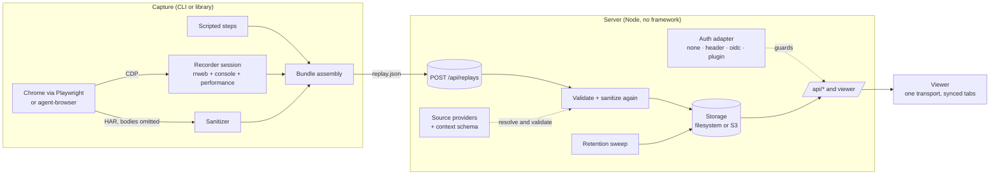

# replays

> The name is chosen (see [docs/NAMING.md](docs/NAMING.md)). It lives in `src/shared/brand.ts`, `package.json` and this
> README. npm package (not published yet): `@hazem3500/replays`; CLI: `replays`; image: `ghcr.io/hazem3500/replays`.

Record what a browser agent, a test or a person did, and replay it with everything that happened around it on **one
timeline**: the page itself (rrweb), the steps taken, console output, a sanitized network trace and performance
timings. One portable `replay.json` (plus an optional MP4), a small upload server with retention, and a viewer you
can host yourself.


- **One timeline.** rrweb events, agent steps, console, network and performance share the same millisecond clock. Click a
  step, a request or a console line and the page jumps there.
- **Built for debugging.** Error markers on the scrubber (console errors, failed requests), previous/next error,
  permalinks (`?t=6.9` or `#step-3`), keyboard shortcuts, a Context tab for test metadata, and Network
  and Performance tabs that lead with what failed or was slow, and when.
- **Capture that survives navigations.** The recorder is registered over the Chrome DevTools Protocol before the first
  page loads, pulls chunks every second and flushes on `pagehide`.
- **Private by default.** Inputs are masked at capture time; cookies, credential headers, URL credentials and sensitive
  query values are removed; request and response bodies are kept only when a capture asks for them, and redacted. See
  the [privacy model](#privacy-model).
- **Self-hostable and pluggable.** Filesystem or S3-compatible storage, `none` / `header` / `oidc` / plugin auth, your own
  context schema, source-link providers, theming, base path, retention. Optional OpenTelemetry tracing.

## Quickstart

### Run the viewer and server

```bash
git clone https://github.com/hazem3500/replays.git && cd replays
docker compose up --build        # builds locally; nothing is pulled from or pushed to a registry
open http://localhost:8080       # two sample replays are included
```

Without Docker (Node 22.22+ (22.x), 24.11+ (24.x), or 26+ and pnpm 10):

```bash
pnpm install
pnpm dev                          # http://localhost:3000, hot reload, AUTH_MODE=none
# or, production shaped:
pnpm build && pnpm start          # http://127.0.0.1:8080
```

The default `AUTH_MODE=none` is for local use. Read [Authentication](#authentication) before exposing the server.

### Record inside your app

Use the browser-only [`@hazem3500/replays/recorder`](docs/recorder.md) entry for consent, private capture and a minimal customizable floating UI. The host supplies its upload transport; no Node or React code enters the browser bundle.

### Compose your own player

Use the [public model, diagnostics, playback and optional React entries](docs/playback-and-model.md) to build your own
controls and panels around independent recording instances. The [composed viewer example](examples/composed-viewer/)
includes both React and native DOM hosts without the application router, API or auth provider.

### Capture a replay

```bash
pnpm exec playwright install chromium         # once, unless Chrome is installed (set CHROME_PATH to use it)

pnpm capture \
  --url https://example.com \
  --title "Example Domain" \
  --steps '[{"kind":"wait","ms":800},{"kind":"click","selector":"a","label":"Follow the link"}]' \
  --output ./out \
  --upload-url http://localhost:8080/api/replays      # optional: send it straight to a server
```

`./out/replay.json` is the whole recording. Open it by uploading it in the viewer (the upload button, or drag and
drop), or `POST` it to `/api/replays`. The CLI prints one JSON line (`{"success":true,…}`), so agents and CI can parse it.

Steps are a closed list: `click`, `hover`, `type`, `fill`, `press`, `wait`, `scroll`, `goto`. Arbitrary page scripts are
intentionally not a step. `--steps` takes inline JSON or `@steps.json`; `sample/demo-shop.steps.json` is a longer one.
Use `--step-pause 1200` to hold each non-wait action for a readable beat (default: 0ms, or
`capture.stepPauseMs` in your config). Built-in drivers type at 80ms per character; `fill` is immediate.
Unlabelled waits execute without adding a step. Labels use selector names without typed values.
See [capture pacing](docs/extending.md#capture-pacing) for host configuration. `--profile <id>` applies that profile's
[capture defaults](docs/extension-api.md#capture-profiles) under the explicit flags; `--network bodies` also keeps redacted
request and response bodies (off by default).

```text
replays capture --url <url> --output <dir> [--steps <json|@file>] [--title] [--id] [--driver playwright|agent-browser]
                   [--viewport 1440x900] [--step-pause 0..10000] [--video] [--tag t]… [--person role:email[:handle=value]]…
                   [--source github:owner/repo#12]… [--profile id] [--network headers|off|bodies] [--no-performance]
                   [--context-file f.json] [--context-schema schema.json] [--suite-id s --run-id r]
                   [--upload | --upload-url <server>/api/replays] [--login] [--header-file headers.json] [--headed [--manual [--max-duration 3m]]]
```

`--headed --manual` records you instead: it opens the browser at `--url` and keeps everything you do until you close the
window or page, press Enter in the terminal (only when stdin is a terminal), or send SIGINT or SIGTERM (a second SIGINT
aborts). `--max-duration 90` (seconds, or `90s`, `2m`) caps it; the default is three minutes, the most ten. It cannot be
combined with `--steps`, and `--output` may be left out (the replay goes to `./<id>`). The steps come from what the page
shows of your actions, named the way the in-app recorder names them: `Clicked “Pricing”`, `Requested “Sign up”`, and
`Opened Pricing` for a page change (a click that causes one is folded into it); typed values and selectors are never kept.
Privacy, `--network`, `--viewport`, `--performance` and `--upload` apply as in any capture.

A selector in a step acts on its first visible match. Test one before recording with
`replays probe --url <url> --selector <selector> [--state <storageState.json>] [--viewport <WxH>] [--json]`, which lists every match with visibility and bounding box.

`replays` is the package's `bin` (`bin/replays.mjs`); from a checkout, `pnpm cli <command>` or
`pnpm capture` run the TypeScript sources directly. The package is **not published**; see
[docs/releasing.md](docs/releasing.md).

Other commands: `replays import --rrweb events.json --title "…"` (a plain rrweb recording made by a person),
`replays upload replay.json`, `replays login|status|logout`, and `replays serve`.

### Connect the CLI to a server

The CLI is not published to npm yet. If you do not already have a checkout, set it up first with a supported Node.js version and pnpm 10:

```bash
git clone https://github.com/hazem3500/replays.git && cd replays
pnpm install --frozen-lockfile
pnpm build
pnpm build:cli
npm install -g .
replays connect https://replays.example.com/workspace
replays doctor
replays upload ./out/replay.json
```

Build and install from the checkout once. The installed `replays` command then works from any directory; contributors can also run the sources with `pnpm cli` from the checkout.

Save a viewer base URL once, including any deployment base path, then upload recordings by filename:

```bash
replays connect https://replays.example.com/workspace
replays doctor
replays upload ./out/replay.json
```

`connect` stores a named server and makes it the default in the platform config directory (`$XDG_CONFIG_HOME/replays/config.json`,
or the platform equivalent). It stores no credentials. Add another server with `--name staging`; select it with
`--server staging`. Upload target precedence is explicit `--upload-url`, explicit `--server`, `REPLAYS_SERVER_URL`,
`REPLAYS_SERVER`, then the saved default. Server URLs must use HTTPS except on loopback. `doctor` checks Node, Chrome, ffmpeg, reachability and your saved
sign-in, and reports whether this server advertises a supported CLI login; it does not prove that a user can upload.
Use `replays config` to list saved server names and URLs, and `replays config reset` to remove the saved configuration.

At a terminal the CLI shows a branded header, spinners, aligned status blocks and clickable links. Output is plain, with no colour or
spinners and the same exit codes, when it is piped, in CI (`CI`), with `NO_COLOR`, or with `--json`. Agents can use `--json` on
`capture`, `upload`, `status` and `doctor` for one stable JSON object, and `replays agent-guide` prints markdown generated from the
same command definitions as `--help`. A distribution can enable a once-a-day update notice (stderr, terminal only, never in CI or
`--json`) by setting `REPLAYS_UPDATE_URL` to its registry's `latest` document and, optionally, `REPLAYS_UPDATE_COMMAND`; users opt
out with `REPLAYS_NO_UPDATE_CHECK=1`.

If `doctor` reports OIDC device login, run `replays login` once. The CLI displays the provider's approval URL and short code;
after approval it saves an upload-only session and resumes. Later uploads reuse it, refreshing tokens when the provider
supports refresh tokens. `replays status` shows the signed-in identity and expiry; `replays logout` removes local credentials
and requests provider revocation when advertised. macOS uses Keychain through the system Swift runtime; Linux uses Secret
Service through `secret-tool` when available. Elsewhere, credentials live in a separate owner-only `0600` file under the
platform config directory (on Windows, the directory inherits the current user's profile ACL). `REPLAYS_CREDENTIAL_STORE=file`
forces the file fallback for managed environments.

Device login is opt-in: an OIDC deployment must use a public client, publish a device authorization endpoint, accept the
RFC 8707 resource indicator, issue an access token whose audience equals that resource and includes `replays:upload`, and
set `OIDC_DEVICE_FLOW=true`. By default the resource is the configured public origin plus deployment base path, and
`OIDC_AUDIENCE` must match it; `OIDC_DEVICE_RESOURCE` can set a deployment-specific resource explicitly, with
`OIDC_AUDIENCE` set to the same value. In this mode the server accepts that token only on replay POST and video PUT uploads
(plus a self-status response); it cannot read replays, approve Keep, manage credentials, or access the MCP bridge. The
provider's device approval page is responsible for the user's sign-in and approval. Deployments behind IAP that intercept
the provider endpoints, `header`, `plugin`, and OIDC without this explicit device capability do not get an automatic browser
login. Use their existing host-auth headers with `--header-file headers.json`, or ask the deployment owner to add a trusted
provider integration. The CLI never scrapes cookies or reuses browser sessions.

`--header-file` explicitly uses host-managed headers and bypasses automatic device login. It must contain a private JSON object
of header names and values; never commit it. A standalone `--upload-url` is never sent a saved token unless it exactly matches
the configured server's canonical `/api/replays` endpoint. Captures stay local by default; use `capture --upload` for the
saved server, or `capture --upload-url <endpoint>` for an explicit destination.

### Record from your own Playwright test

The recorder is a library (`import … from '@hazem3500/replays'` after `pnpm build:cli`): attach it to any Chrome DevTools
Protocol connection.

```ts
import { RecorderSession } from '@hazem3500/replays';

const session = await RecorderSession.start(await context.newCDPSession(page)); // before the first navigation
await page.goto('https://example.com');
await page.getByRole('link').click();
const tracks = await session.stop(); // { events, console, performance, origin, duration }
```

`stop()` gives the page-side tracks; combine them with a HAR (`networkEntries`) and your steps into a
`ReplayBundle` (see `src/capture/capture.ts` for the reference assembly) and upload it.

### Inspect network and performance

**Network** opens on one toolbar row: status chips that are also the summary (All, Failed, Slow at 500 ms or more,
No response), a type menu and search. A busy recording also gets a ribbon on the seek bar's own time axis: request
density, failures as red ticks, slow spans in amber and the playhead. Click the ribbon to seek, or drag across it to
list only that stretch. Each row shows when the request started (click to seek), its status, its duration on a log scale
and the action it belongs to. Select a row for its detail beside the list (in its place on a phone): how long it took
against the recording's median, the step it belongs to, what else was in flight on the request's own scale, the
retained headers, Copy URL and Copy as cURL. ↑/↓, Home/End and Escape work from the keyboard.

**Performance** leads with verdicts: first and largest paint, the slowest interaction, the longest task and total
blocking time, each marked Good, Needs work or Poor, or "Not captured" when the browser couldn't observe it. Below
them are the slow moments, worst first or in time order. A click's pointer, key and input events count as one moment,
and each moment says what it was during and what it most likely waited on: a long task, requests in flight, or the
page's own code. Script attribution is not captured, so the detail says so instead of guessing.

With saved edits, rows follow the edited replay clock through trims, cuts and speed-ups, and details keep the source
measurements. Missing responses have unknown duration. Older bundles work with the tracks they contain; no additional
capture data is needed.

## Architecture



| Part | Where |
| --- | --- |
| Recorder (page side), session, drivers, sanitizer, importers | `src/capture` |
| Bundle types and validation, context, source providers, retention | `src/shared` |
| HTTP app, auth, storage, retention, tracing, optional video/poster rendering | `src/server` |
| Viewer | `src/client` |

A replay is one JSON document:

```text
replay.json
├─ meta        id, title, url, capturedAt, duration, viewport, source (agent|human), tags
├─ events      rrweb events (masked inputs)
├─ steps       what the agent or script did, with times
├─ console     level, message, time
├─ network     method, url, status, timing, redacted request/response headers (bodies only when opted in)
├─ performance paint, long tasks, slow interactions
├─ context     optional: app/build, test, source links, your own fields
└─ suiteRun    optional: attaches the replay to a suite run
```

## Configuration reference

Settings come from environment variables. Non-secret settings can also live in a JSON file
(`REPLAYS_CONFIG=/etc/replays/config.json`); the environment wins. Secrets are environment-only.

### Server

| Variable | Default | Meaning |
| --- | --- | --- |
| `PORT` | `8080` (`3000` with `--dev`) | Listen port |
| `HOST` | `127.0.0.1` (`0.0.0.0` in the Docker image) | Listen address |
| `BASE_PATH` | `/` | Serve under a prefix, e.g. `/replays`. The bare (prefix-stripped) shape is accepted too, for proxies that strip it. `hosts` in the config file gives single hosts their own base ([operations](docs/operations.md#several-hosts-one-process)) |
| `TRUST_FORWARDED_HOST` | `false` | With `hosts`: pick the host from `X-Forwarded-Host` (a gateway that rewrites `Host`). Also `trustForwardedHost` |
| `PUBLIC_ORIGIN` | – | `https://replays.example.com`; needed by `oidc` for the redirect URI |
| `TLS_CERT_FILE`, `TLS_KEY_FILE` | – | Serve HTTPS directly (usually a proxy does this instead) |
| `DATA_DIR` | `./.data/replays` (`/data` in Docker) | Where the filesystem driver stores replays |
| `STORAGE` | `fs` | `fs`, `s3`, or a backend a plugin registered |
| `RETENTION_DAYS` | `30` | Days an upload lives, counted from its upload time; `0` keeps everything. "Kept" replays never expire |
| `RETENTION_PROFILE_<ID>_DAYS` | – | Days for replays of one [profile](docs/extension-api.md#profiles-and-retention) (`RETENTION_PROFILE_DESIGN_REVIEW_DAYS`); `0` keeps explicit ones forever |
| `REPLAYS_CONFIG` | `replays.config.{ts,mjs,js,json}` in the working directory | The config file (below); a script can also list [plugins](#extending-replays) |
| `SAMPLE_DIR` | the bundled `sample/` | Directory of read-only demo replays; point it at an empty directory for none |
| `PRODUCT_NAME`, `LOGO_URL` | `replays`, – | Branding (name in the header and title; logo must be an `https:` URL or a `data:image/…;base64` URL) |
| `CONTEXT_SCHEMA_FILE` | – | JSON Schema for `context.fields` (see [Context schema](#context-metadata-schema)) |
| `GITHUB_HOST`, `GITLAB_HOST` | `github.com`, `gitlab.com` | Hosts the `github:` / `gitlab:` source providers link to (self-managed instances) |
| `OTEL_EXPORTER_OTLP_ENDPOINT` | – | Turns tracing on; standard `OTEL_*` variables apply. Off (and not even loaded) when unset |
| `REPLAYS_BETA_EDITOR` | `false` | Turns on the beta replay editor (below). Also `beta.editor` in the config file; the variable wins |
| `EDITING_ENABLED` | `true` | Host edit write policy within `beta.editor`; `false` hides editing and rejects saves while saved edits still play and export. Also `editing.enabled` in config |
| `REPLAYS_BETA_CURSOR_CUSTOMIZATION` | `false` | Allows cursor customization in Settings > Labs; opt in there to show the collapsed editor controls. Also `beta.cursorCustomization` in config. Saved cursor edits still play and export when off |
| `REPLAYS_BETA_MALLEABLE` | `false` | Turns on the beta plugin workshop and agent bridge ([Malleable viewer](#malleable-viewer-beta-off-by-default)). Also `beta.malleable` in the config file; the variable wins |
| `REPLAYS_COMMENTS` | `true` | Comments on replays (below). `false` removes the UI and makes the API answer `404`. Also `comments.enabled` in the config file; the variable wins |
| `RENDER_DISABLED=1`, `POSTERS_DISABLED=1` | – | Turn off video export / list posters even when Chromium and ffmpeg exist |
| `RENDER_ASSETS` | `public` | Render public third-party assets; `origin-only` restricts requests to this server and the explicit allowlist |
| `RENDER_ASSET_ALLOWLIST` | – | Comma-separated exact hostnames or IPs trusted for internal render assets; permits their private addresses |
| `CHROMIUM_PATH`, `FFMPEG_PATH`, `CHROMIUM_NO_SANDBOX=1` | autodetected | Server-side video export and list posters (optional) |

The config file takes `name`, `logoUrl`, `theme`, `basePath`, `hosts`, `trustForwardedHost`, `retentionDays`, `contextSchemaFile`, `githubHost`,
`gitlabHost`, `sourceProviders`, `beta`, `editing`, `comments`, `auth`, `storage`, `plugins`, `redaction` and `privacy`:

```json
{
  "name": "Acme Replays",
  "theme": { "dark": { "accent": "#7aa2ff" }, "light": { "accent": "#2f55d4" } },
  "basePath": "/replays",
  "retentionDays": 14,
  "contextSchemaFile": "./context.schema.json",
  "sourceProviders": [{ "id": "jira", "label": "Jira", "template": "https://jira.example.com/browse/{ref}", "pattern": "^[A-Z]+-\\d+$" }]
}
```

### Storage

| Variable | Meaning |
| --- | --- |
| `STORAGE=fs` | Files under `DATA_DIR` (default) |
| `STORAGE=s3` | An S3-compatible bucket: `S3_BUCKET` (required), `S3_REGION` (`us-east-1`), `S3_ENDPOINT` (MinIO, R2, …), `S3_FORCE_PATH_STYLE=1`, `S3_PREFIX`, and credentials from `AWS_ACCESS_KEY_ID`, `AWS_SECRET_ACCESS_KEY`, `AWS_SESSION_TOKEN` |

### Capture

| Variable | Meaning |
| --- | --- |
| `CHROME_PATH` | Chrome/Chromium binary for the Playwright driver (default: Playwright's own browser) |
| `CHROMIUM_NO_SANDBOX=1` | Pass `--no-sandbox` (containers) |
| `FFMPEG_PATH` | ffmpeg for `--video` with the Playwright driver |
| `AGENT_BROWSER_BIN` | Binary of the optional `agent-browser` driver |

## Authentication

One adapter per process, chosen by `AUTH_MODE`. Protected routes go through it; `GET /healthz`, `GET /` from a
non-browser, and the credential-free `GET /api/cli/auth/capabilities` probe are public. State-changing requests from a
browser must be same-origin (`Sec-Fetch-Site`).

| `AUTH_MODE` | Behaviour | Settings |
| --- | --- | --- |
| `none` (default) | Everyone is one anonymous user. For local use, or a network that already decides who may connect. A warning is logged when it listens on a non-loopback address | `DEV_USER` names the identity |
| `header` | Trust an identity header set by a reverse proxy that already authenticated the user (oauth2-proxy, an ingress, …). Only requests from `AUTH_TRUSTED_PROXIES` count | `AUTH_HEADER`, `AUTH_TRUSTED_PROXIES` (IPs or IPv4 CIDRs, **required**), `AUTH_NAME_HEADER`, `AUTH_ALLOW` (`@domain` or exact ids) |
| `oidc` | OpenID Connect sign-in (authorization code + PKCE, signed session cookie). Bearer JWTs are accepted for machine uploads. Device login is off unless `OIDC_DEVICE_FLOW=true`; then bearer JWTs must include `replays:upload` and are restricted to upload routes. | `OIDC_ISSUER`, `OIDC_CLIENT_ID`, `OIDC_CLIENT_SECRET` (omit for public device client), `OIDC_SESSION_SECRET`, `PUBLIC_ORIGIN`, `OIDC_SCOPES`, `OIDC_AUDIENCE`, `OIDC_DEVICE_FLOW`, `OIDC_DEVICE_RESOURCE`, `AUTH_ALLOW` |
| `plugin` | Your own adapter: `AUTH_PLUGIN=./my-auth.mjs`, default export `(env) => AuthAdapter` | whatever the plugin reads |

[`examples/auth-signed-header`](examples/auth-signed-header) is a worked plugin: it verifies a signed JWT that an
identity-aware proxy forwards in a header (signature, issuer, audience, expiry).

Uploads from CI need credentials the adapter understands. Automatic device login is only started by an interactive upload or
an explicit `replays login`; noninteractive uploads fail quickly with the login command when the session is missing. For
`header`, IAP, and custom adapters, `--header-file` carries the host's expected upload headers.

## Extension points

All of these are typed, documented in [docs/extending.md](docs/extending.md) and covered by tests.

| Extension point | What you provide | Built in |
| --- | --- | --- |
| **Auth adapter** | `AuthAdapter { authenticate, handle?, loginUrl? }` | `none`, `header`, `oidc`; example plugin in `examples/` |
| **Context metadata schema** | A JSON Schema file. Uploads whose `context.fields` do not match are refused (400 with the field path); the viewer renders the fields with your titles, descriptions, order and `format: uri` links | – |
| **Source-link providers** | `--source github:owner/repo#12` → a link. `{ id, template: 'https://…/{ref}', pattern? }` for your tracker | `github`, `gitlab`, `url` |
| **Storage** | `ObjectStorage` interface (read, write with `createOnly`/`ifVersion`, list, delete, stream with ranges) | `FsStorage`, `S3Storage` (SigV4 over `fetch`, no SDK); `MemoryStorage` for tests |
| **Theming and branding** | `PRODUCT_NAME`, `LOGO_URL`, `theme.dark` / `theme.light` design tokens (`accent`, `surface`, `text`, `line`, `ring`, `sans`, …) applied at runtime without a rebuild | Neutral indigo/slate theme |
| **Base path, retention** | `BASE_PATH`, `RETENTION_DAYS` | – |
| **Capture driver** | `CaptureDriver` interface (launch, open, step, finish) | `playwright`, `agent-browser` |

### Context (metadata schema)

A producer can attach a context block to a recording: which app and build, which test, links, and fields of your own.

```json
{
  "app": { "name": "Demo shop", "environment": "staging", "version": "2.4.1", "commit": "a1b2c3d" },
  "test": { "suite": "checkout", "case": "rejects an unknown coupon", "runId": "ci-8421" },
  "sources": [{ "provider": "github", "ref": "acme/shop#42" }, { "provider": "jira", "ref": "SHOP-17" }],
  "fields": { "plan": "trial", "featureFlags": { "newCheckout": true } }
}
```

```bash
replays capture … --context-file context.json --context-schema context.schema.json
```

It comes from your runner; the CLI never reads the page's storage or an account. With `CONTEXT_SCHEMA_FILE` set, the
server validates `fields` (JSON Schema 2020-12 via Ajv, with string formats) and `GET /api/config` hands the schema to
the viewer, which uses `title`, `description`, property order and `format: "uri"` to render the Context tab. Without a
schema, fields still render, with humanized key names.

## Extending replays

To run your own branded, authenticated variant without forking, depend on this package and describe the differences in a
config file and plugins. One package, six entry points (`/config`, `/plugin`, `/viewer`, `/server`, `/capture` and the root):

```ts
// replays.config.ts
import { defineConfig } from '@hazem3500/replays/config';
import { definePlugin } from '@hazem3500/replays/plugin';

const acme = definePlugin({
  name: 'acme',
  setup(api) {
    api.auth({ name: 'acme-sso', create: (env) => ({ name: 'acme-sso', authenticate: (request) => (request.headers['x-team-key'] === env.TEAM_KEY ? { id: 'team' } : undefined) }) });
    api.contextAdapter({ name: 'build', schema: { type: 'object', properties: { env: { type: 'string', title: 'Environment' } } } });
    api.branding({ name: 'Acme Replays', theme: { dark: { accent: '#ff6600' } } });
    api.basePath('/replays');
    api.client({ id: 'main', script: new URL('./dist/client.js', import.meta.url).pathname }); // inspector tabs, actions, panels
  },
});

export default defineConfig({ plugins: [acme] });
```

Plugins can register auth adapters, test-context adapters, source-link providers, storage backends, branding, the base path, server hooks
(request, response, upload lifecycle) and a browser entry that adds inspector tabs, viewer actions and panels. Start it with
`replays serve`, or `startServer()` from `@hazem3500/replays/server`.

- [docs/extension-api.md](docs/extension-api.md): the reference, with every registration, ordering and conflict rule
- [docs/api-stability.md](docs/api-stability.md): what is public API, versioning and deprecation rules
- [docs/packaging.md](docs/packaging.md): why one package with subpath exports
- [`examples/custom-distro`](examples/custom-distro): a runnable distribution (signed-header auth, context adapter, branding, base
  path, a custom tab, action and panel) with an end-to-end test that proves each extension is active
- [docs/downstream-migration.md](docs/downstream-migration.md): moving an existing internal fork onto this surface

## Privacy model

A replay contains what was on the screen, so the defaults are conservative and the server does not trust its clients.

| Data | What happens | Where |
| --- | --- | --- |
| Typed input | rrweb `maskAllInputs` (plus `hidden` inputs): values never leave the page. Uploads and imports are re-masked on the server. A host can keep the values of signed-in staff recordings made with visible inputs (`privacy.keepVisibleInputs`, off by default); passwords and hidden inputs stay masked ([docs/extending.md](docs/extending.md#visible-inputs-for-staff-recordings)). Customer picks keep typed values and bodies only with `privacy.keepCustomerChoices` and a matching claim ([docs/extending.md](docs/extending.md#customer-choices-on-upload)) | `src/capture/injected-recorder.ts`, `sanitize.ts`, `src/server/privacy-config.ts` |
| Cookies | Not stored: no `Cookie` / `Set-Cookie` headers, no HAR `cookies` arrays | `sanitize.ts` |
| Credential headers | `Authorization`, `Proxy-Authorization`, `X-Api-Key`, `X-Auth-Token`, anything ending in `-token`, `-secret`, `-jwt`, `-assertion` are dropped | `sanitize.ts` |
| URL credentials | `user:pass@` removed everywhere (events, steps, network, console, context) | `sanitize.ts` |
| Sensitive query values | `token`, `api_key`, `password`, `session`, `code`, `email`, `signature`, … (and `*_token`, `*-secret`, …) become `[redacted]`, also inside URL fragments and in text | `sanitize.ts` |
| Request and response bodies | Off by default. Opt-in (`--network bodies`, recorder `capture.network: 'bodies'`): JSON, text and form only, cut at 64 KiB, with secret fields, credentials, JWTs, card numbers and e-mail addresses redacted at capture and again on upload | `src/shared/network-bodies.ts`, `src/recorder/body-capture.ts` |
| Uploads | Sanitized again on the server before storing; the pass is idempotent | `app.ts` |
| Your own rules | Extra headers, query parameters, JSON keys, text patterns and mask selectors from the config's `redaction` or a plugin's `api.redaction`, applied at capture and again on upload. They add to the defaults and cannot turn any off ([docs/extending.md](docs/extending.md#redaction-rules)) | `src/shared/redaction.ts` |
| Retention | Uploads expire after `RETENTION_DAYS`, from the *server's* upload time; "keep" pins one | `src/shared/retention.ts` |
| Links in the viewer | Only `https:` URLs without credentials are rendered as links | `shared/context.ts` |
| Server-side render route | Loopback-only, per-process token, refused when any proxy header is present | `render-routes.ts` |
| Telemetry | The viewer and server send nothing anywhere. Optional OTLP traces carry route templates, ids, sizes and counts, never titles, URLs, bodies or identities | `tracing.ts` |

What the sanitizer cannot know: text that is *visible on the page* (names, order numbers, messages) is recorded as
shown. Keep the server behind authentication, keep retention short, and do not record real users' production sessions
without a legal basis. Report privacy bugs through [SECURITY.md](SECURITY.md).

## Comments

Anyone who can open a replay can comment on it, Loom style. A comment is about the **whole replay** or **pinned to a
moment**; pinned ones are markers (avatar or initials) on the seek bar, with a hover card; a click seeks there. The
**Comments** tab lists every thread in time order, highlights the one at the playhead and follows it while the replay
plays. Threads take replies and can be **resolved** and reopened by anyone; **edit and delete are for the author only**
(deleting a thread deletes its replies). Emoji **reactions** (👍 🎉 👀 🤔 🐛) can be pinned to a moment too.

- **Shortcut.** `M` pauses and starts a comment at the current time (`C` is Console and `Shift C` the step captions, so
  it was taken); `Ctrl`/`⌘` + `Enter` posts. It is in the `?` sheet. Shortcuts pause while you type.
- **Permalinks.** *Copy link* on a comment gives `…/r/<id>?t=5.0#comment-<id>`: it opens the Comments tab on that comment
  and seeks to it. `?t=` is the fallback; the comment decides.
- **Anchoring.** Comment times are stored on the **source** timeline (ms from the first event of the recorded replay), the
  same clock saved edits use, so editing never moves a comment. With the beta editor's edits applied
  (`REPLAYS_BETA_EDITOR=true`) markers are mapped source → edited time (trims shift them, cuts close up, speed-ups
  compress), and a comment made while watching the edited version is mapped back. A comment inside a trimmed or cut stretch
  stays in the list, marked **In removed section** with a *View in original* link (`?original=1`); it has no marker and
  does not seek. The original recording shows every marker.
- **Who.** Authors come from the auth adapter (`id` for ownership, `name`, optional `avatarUrl`; the OIDC adapter reads the
  `picture` claim, plugins may return `avatarUrl`). Other viewers only get the display name and a `mine` flag, never the
  id. With `AUTH_MODE=none` there is no identity to speak of: comments are posted as **Anonymous**, the panel says so, and
  anyone with access can edit or delete anonymous comments.
- **Limits.** 2000 characters per comment, 500 comments per replay, 100 replies per thread; control and bidi-override
  characters are stripped and URLs in the text get the upload redaction. Creating and editing are limited to 20 per minute
  per person (`429` with `Retry-After`). Comments live in `<id>/comments.json` on the storage driver (filesystem or S3), so
  retention deletes them with the replay and **Keep** keeps them.
- **Flag.** On by default. `REPLAYS_COMMENTS=false` (or `{ "comments": { "enabled": false } }`) removes the tab, markers
  and shortcut, never requests comments, and answers the API with `404`; stored comments stay until retention.
- **A built-in plugin.** Comments are the `comments` plugin of the [extension surface](#extending-replays): the API is a request hook
  behind whatever auth adapter is in use (a plugin's adapter included: its identity, name and `avatarUrl` become the author), and
  the tab, seek-bar markers and `M` key are the matching viewer feature. Turning comments off means the plugin is not loaded.


## Beta features and Labs

Beta features are decided in two places, listed once in [`src/shared/beta-flags.ts`](src/shared/beta-flags.ts):

1. **The server allows them.** Every flag is off until an admin sets its variable or config key (the variable wins):

   | Flag | Variable | Config file | In Settings › Labs |
   | --- | --- | --- | --- |
   | Replay editor | `REPLAYS_BETA_EDITOR` | `beta.editor` | On by default; turning it off hides editing (saved edits still play) |
   | Cursor customization | `REPLAYS_BETA_CURSOR_CUSTOMIZATION` | `beta.cursorCustomization` | Off by default; opt in to the collapsed editor controls. Saved cursor settings still play and export |
   | Plugin workshop | `REPLAYS_BETA_MALLEABLE` | `beta.malleable` | On by default; turning it off loads no plugin code or agent bridge (applies after a reload) |

   A flag the server does not allow does not exist for anyone: no UI, its routes answer `404`, its code is never loaded.
   The page learns the allowed set from `<meta name="app-beta">` and `GET /api/config` (`beta`).
2. **Each person opts out (or back in) under Settings › Labs.** Only allowed flags are listed; with none allowed, Labs says
   so. Choices are saved in the browser today; the client keeps them behind one store
   (`setLabsChoiceStore` in `src/client/settings/labs.ts`) so per-user storage can replace it once sign-in carries preferences.

In short: effective = allowed by the server ∧ (the person's choice, or on by default).

## Replay editor (beta, off by default)

Edit mode lets you tidy a recording without touching it: trim the start and end, cut ranges, **Remove waits** (cuts the
idle stretches between steps), speed a stretch up, add **zoom** regions on the clicks, **blur boxes** over parts of the
page, and **captions** (written from the steps). Open it with the *Edit* button in the viewer or at `/r/<id>/edit`.

- **Non-destructive.** Edits are an edit list stored next to the replay (`<id>/edits.json`); `replay.json` is never
  rewritten. The viewer plays the edited version with an "Edited" label and a switch to the original (`?original=1`);
  video exports apply the edits and are cached per edit-list version. Saves are optimistic (`If-Match`), so two people
  cannot silently overwrite each other, and free text in labels goes through the same URL redaction as uploads.
- **Flag.** `REPLAYS_BETA_EDITOR=true`, or `{ "beta": { "editor": true } }` in the config file (the variable wins).
  The server tells the page through `<meta name="app-beta">` and `GET /api/config` (`beta.editor`).
- **Read-only editing.** Keep `beta.editor` on and set `{ "editing": { "enabled": false } }` or `EDITING_ENABLED=false`.
  Edit links disappear and edit deep links open playback. Saved edits still play and export; GET/HEAD edits and ETag
  revalidation work, while PUT returns `403`. `GET /api/config` reports the effective `editing.enabled` capability.
  See [host editing policy](docs/extension-api.md#host-editing-write-policy) for precedence and validation.
- **With the flag off** (the default): no Edit button or "Edited" label, `/r/<id>/edit` just opens the replay, the
  `GET|PUT /api/replays/<id>/edits` endpoints answer `404`, exports ignore any edit list, and the editor's code chunk is
  never requested. A client can never switch it on by itself (an editor without its API cannot save), so the server
  allows it; each person can then hide editing under Settings › Labs. For local preview run `REPLAYS_BETA_EDITOR=true pnpm dev`.
- **From the terminal.** `replays edit <id|viewer-link> <command>` does everything the editor saves, for people and agents
  without a browser; see [CLI editing](#cli-editing).
- It is a beta: the edit-list format (`src/shared/edits.ts`, `src/shared/effects.ts`) may still change before 1.0.


### CLI editing

`replays edit` uses the same server, sign-in and `--header-file` as `upload` (`replays connect`, `replays login`), and the same
`GET|PUT /api/replays/<id>/edits` routes and validators as the editor, so a CLI edit and a browser edit are the same edit.

```bash
replays edit <id> show                      # numbered steps and edits (add --json for agents)
replays edit <id> rename 7 "Open the invoice"   # a step number, or its time: 12.3s
replays edit <id> cut --from 10s --to 18s
replays edit <id> cut waits --min 2s        # the editor's "Remove waits"
replays edit <id> speed --from 20s --to 40s --rate 4
replays edit <id> zoom --from 3s --to 6s --rect 25%,25%,50%,50%
replays edit <id> blur --from 3s --to 6s --rect 10%,10%,20%,20%    # remove: a solid block instead
replays edit <id> caption add --from 3s --to 6s "Signing in"
replays edit <id> highlight add --at 14.9s "Look here"
replays edit <id> pull -o edits.json        # round-trip the whole list; then: push edits.json
replays edit <id> export --speed 2 -o edited.mp4
```

Times are `12.3s`, `1:02.5`, `1500ms`, `start` or `end`. Every command prints what changed and the viewer link, and takes
`--json`. Each change is a read-modify-write with `If-Match` and one retry when someone saved in between; `push` refuses a file
older than the server's list (`--force` overwrites) and shows a diff first (`--dry-run` stops there). Renaming steps needs your
sign-in email to match a person on the replay, or the admin role; every other edit is open to anyone who can open the replay.
The server keeps no edit history, so there is no `undo`; `pull` a backup before a big change. `replays edit --help` has the
full reference.

## Malleable viewer (beta, off by default)

The viewer can be reshaped while it runs: write a small **plugin** (an inspector tab, a side panel, a More-menu action) in an in-app
editor and it hot-loads; keep it as a versioned, diffable, revertable file, per user or for the workspace; or let a **coding agent**
read the open replay and write the plugin for you ("add a tab that groups failed requests by endpoint", "comment on every console
error"). Plugins run in a sandboxed frame with no network, no cookies and no access to the page; they can only use the capabilities
their manifest declares, and anything that writes (a comment, a download) asks you first. Nothing is stored unless you approve it
in a dialog that shows the diff and the permissions, and an agent has no way to save anything.

- **Flag.** `REPLAYS_BETA_MALLEABLE=true`, or `{ "beta": { "malleable": true } }` in the config file (the variable wins). The page
  learns it from `<meta name="app-beta">` and `GET /api/config` (`beta.malleable`). Open **More → Plugin workshop** in a replay.
- **Agents.** In the page, tools are registered with [WebMCP](https://webmachinelearning.github.io/webmcp/) (`document.modelContext`;
  a small stand-in is installed where the browser has none). From outside, *Agent → Connect an agent* shows a one-tab bridge token for
  `replays mcp`, an MCP server over stdio (`REPLAYS_URL=… REPLAYS_BRIDGE_TOKEN=… replays mcp`). The tools read live state (open replay,
  playhead, comments, network and console) and load *draft* plugins; there is no save tool.
- **Formats.** Replays, comments, edits and plugins are plain JSON with JSON Schemas in [docs/formats/](docs/formats/); example plugins
  are in [examples/malleable/](examples/malleable/) (import them from the workshop).
- **Read-only editing.** Keep `beta.editor` on and set `{ "editing": { "enabled": false } }` or `EDITING_ENABLED=false`.
  Edit links disappear and edit deep links open playback. Saved edits still play and export; GET/HEAD edits and ETag
  revalidation work, while PUT returns `403`. `GET /api/config` reports the effective `editing.enabled` capability.
  See [host editing policy](docs/extension-api.md#host-editing-write-policy) for precedence and validation.
- **With the flag off** (the default): no workshop or menu entry, `/api/malleable/*` and `/_malleable/sandbox.html` answer `404`, no
  tools are registered, no extra CSP header is sent, and the plugin code is never requested.
- Design, mapping onto the extension API, the threat model and worked examples: [docs/malleability.md](docs/malleability.md).


## Suites, retention and keep

A **suite** groups the runs of one job (for example every browser flow a pull request triggered): register it with
`PUT /api/suites/<id>` and each run with `PUT /api/suites/<id>/runs/<run>`, then upload each replay with
`--suite-id` / `--run-id`. The viewer shows the suite's runs, status and a link to its subject. **Keep** (`PUT
/api/replays/<id>/keep`) exempts a replay or suite from retention and records who kept it.

From the CLI, `replays suite create --id <id> --title "…"` registers a suite and prints its link, `replays suite run add|set` moves a
run from `running` to `passed` or `failed`, and `replays suite show <id>` reads the runs back. `replays suite record --plan plan.json
--upload` does the whole job from one file ([schema](docs/formats/suite-plan.schema.json), [example](sample/suite-plan.json)): it
registers the suite, records each run with the capture steps, uploads it to its run and marks it, carrying on past a failed run.
`replays suite --help` lists everything.

## HTTP API

| Route | |
| --- | --- |
| `GET /healthz` | `200 ok`, no auth |
| `POST /api/replays` | Upload a `replay.json` (≤ 25 MB, optionally `Content-Encoding: gzip`) → `201 { id, url }` |
| `POST /api/replays/import` | Upload plain rrweb JSON (`?title=&url=&id=&tag=`) |
| `PUT /api/replays/<id>/video` | Attach an MP4 |
| `GET /api/replays`, `GET /api/replays/<id>` | List summaries (`?q=&host=&errors=1&source=&tag=`) / the bundle |
| `GET /api/suites`, `GET /api/suites/<id>`, `PUT /api/suites/<id>[/runs/<run>]` | Suites |
| `PUT\|DELETE /api/replays/<id>/keep` | Keep / release |
| `PATCH /api/replays/<id>/meta` | Rename, retag or set the profile (`{ title?, tags?, profile? }`, `profile: null` drops the override) → the summary; the bundle stays as uploaded |
| `DELETE /api/replays/<id>`, `POST /api/replays/<id>/restore` | Delete (restorable for 7 days, then retention removes it; `409` while kept) / restore → the summary |
| `GET\|POST /api/replays/<id>/comments`, `PATCH\|DELETE …/comments/<comment>` | Comments (`{ body, at?, parentId? }`, `{ emoji, at }`, `{ body }` / `{ resolved }`); `at` is source ms |
| `GET /api/me`, `GET /api/config` | Identity; branding and context schema |
| `GET /api/malleable/plugins[/<scope>/<id>]`, `POST …/approvals`, `PUT\|DELETE …/plugins/<scope>/<id>`, `…/bridge/*`, `GET /_malleable/sandbox.html` | User plugins and the agent bridge (beta, `REPLAYS_BETA_MALLEABLE`; `404` when off). Saves need an approval token |

## Development

```bash
pnpm install
pnpm dev          # server + viewer with hot reload
pnpm check        # lint, format check, typecheck, unit tests, build
pnpm test:e2e     # Playwright: capture a sample → upload → viewer loads it, plus UI smoke tests
pnpm build:cli    # dist/cli (bundled CLI), dist/lib (library entries), dist/types
pnpm test:distro  # build everything, then the custom-distro example and its end-to-end smoke
pnpm test:pack    # pack the package and run it from an install outside the repository
pnpm sample       # re-record sample/demo-shop.json from fixtures/demo-shop
pnpm build:site   # the static landing page and live demo in dist/site (see docs/site.md)
```

Requirements: Node 22.22+ (22.x), 24.11+ (24.x), or 26+, pnpm 10, a Chrome/Chromium for capture and the e2e tests. See [CONTRIBUTING.md](CONTRIBUTING.md).

Tooling: [Vite+ 1.4.0](https://viteplus.dev/) provides Vite, Vitest, Oxlint and Oxfmt through the local `vp` CLI.
`pnpm format` / `pnpm format:check` use [.oxfmtrc.json](.oxfmtrc.json); lint policy and the custom Node/library
builds are preserved. See [tooling](docs/tooling.md) and [contributing](CONTRIBUTING.md).

More documentation: [extending replays](docs/extension-api.md) · [API stability](docs/api-stability.md) · [extension points](docs/extending.md) · [operations](docs/operations.md) ·
[releasing](docs/releasing.md) · [landing page](docs/site.md) · [naming](docs/NAMING.md).

## License

[MIT](LICENSE) © 2026 Hazem (hazem3500). rrweb is MIT licensed; the Inter font is bundled under the SIL OFL
(`src/client/fonts/Inter-OFL-LICENSE.txt`).

### Component development and agent framework evaluation

`pnpm storybook` runs isolated viewer, host-context and plugin-permission stories with a light/dark theme toolbar; `pnpm build:storybook` produces a static build. See [Storybook and the Agent-Native adoption design](docs/agent-native-adoption.md) for scope, validation and the evaluated fit of Effect and XState. [The Agent-Native integration spike](examples/agent-native/README.md) uses the actual framework browser client with the existing WebMCP bridge. It is the first migration slice toward Agent-Native as the default application runtime, preserving human Keep approval and portable core storage/auth.
